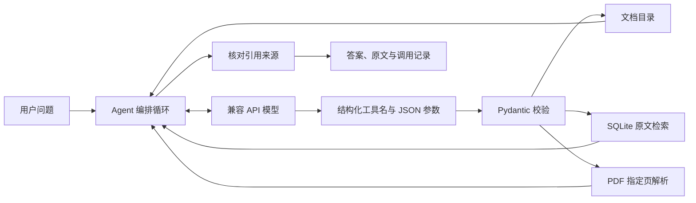

# Papertrail · 本地 PDF 阅读助手

为 BYOA 实验制作的单用途 Agent：导入 PDF 后，用标准 LLM function calling 调用本地工具，检索和阅读原文，生成带物理页码引用的回答。默认使用中文。

## 当前验证状态

- 本地 PDF 导入、关键词检索、原文查看已经运行并验证。
- 13 项自动化测试通过，包括工具参数、标准调用消息往返、错误引用修正、无证据拒答、HTTP 错误脱敏、Qwen 接口兼容、文档访问范围和整份导出。
- 2026-10-31 已通过北京地域百炼 `qwen3.8-27b` 完成真实模型检查：正确提取示例 PDF 中的编号和人数，实际调用本地检索与 PDF 阅读工具，给出有效页码引用。检查仅覆盖这一份原创示例，不能视为通用准确率。
- 自动化测试仍使用明确标识的模拟模型；真实接入检查另存为 `evidence/live-check-*.json`，两者分别记录。
- 浏览器内的真实问答也已验证：编号、人数及局限问题耗时 14.62 秒；“考试成绩提高百分比”这一材料未提供的问题耗时 19.16 秒，回答明确指出未提供数字并引用第 3 页。这是小规模功能验证，不代表整体性能或稳定延迟。
- 示例 PDF 是本项目原创的虚构测试材料，其中编号和人数用于检查答案是否来自本地上下文，不是研究结果。
- UI 已补充首页上传、任务管理、收藏、PDF 与解析文本对照、点击高亮、翻页缩放、当前页 JSON、文档问答和整份导出。PDF.js 的脚本、字体及 CMap 均从本机加载。

## 启动

环境：Python 3.9 及以上，以及 Node.js / npm（安装本地 PDF 预览依赖时使用）。当前已在 macOS / Python 3.9.6 的独立虚拟环境验证。

```bash
git clone https://github.com/kikoloki/lab01.git
cd lab01
python3 -m venv .venv
.venv/bin/python -m pip install -r requirements.txt
npm ci --ignore-scripts
cp -n .env.example .env
```

如果已有 `.env`，保留已有配置，不再复制覆盖。编辑三个变量：

```dotenv
OPENAI_BASE_URL=https://YOUR-PROVIDER.example/v1
OPENAI_API_KEY=YOUR-KEY
OPENAI_MODEL=YOUR-PROVIDERS-EXACT-MODEL-ID
OPENAI_STRICT_TOOLS=false
```

地址填 API 基础路径，不要填网页聊天地址或完整 `/chat/completions` 路径。模型需支持 Chat Completions 的 `tools` 和 `tool_choice`。服务支持 strict 模式时，可把最后一项改为 `true`；本地 Pydantic 校验始终开启。

百炼北京 `qwen3.8-27b` 已验证配置（密钥仅放在本地 `.env`）：

```dotenv
OPENAI_BASE_URL=https://dashscope.aliyuncs.com/compatible-mode/v1
OPENAI_MODEL=qwen3.8-27b
OPENAI_STRICT_TOOLS=false
OPENAI_REQUIRE_TOOL_CHOICE=false
OPENAI_ENABLE_THINKING=false
```

百炼 Qwen 对 `tool_choice=required` 有限制，因此设为 `auto` 让模型选择工具；本项目仍在应用层检查是否取得原文证据。`enable_thinking` 是百炼扩展参数，其他供应商留空以免发送不兼容字段。上述北京兼容地址来自[百炼 API Key 配置文档](https://docs.bailian.console.aliyun.com/zh/model-studio/get-api-key)，参数限制见[百炼 Chat API 文档](https://docs.bailian.console.aliyun.com/zh/model-studio/qwen-api-via-openai-chat-completions)。

```bash
.venv/bin/python -m uvicorn reader.app:app --host 127.0.0.1 --port 8765
```

打开 <http://127.0.0.1:8765>。macOS 也可双击 `start.command`。修改 `.env` 后，打开“模型与阅读空间”并点击“重新检查”，无需重启。配置状态只说明字段齐全，真实连通性以成功问答为准。新安装 PDF.js 资源后需重启本地服务。

## 使用与课堂演示

1. 在首页上传自己的文字型 PDF，或点击原创示例。上传进度代表实际传输字节；传输完成后显示原文提取状态。
2. 阅读工作台左侧显示 PDF 原文件，右侧为解析文本。支持翻页、缩放，点击任意文本块即可在原文中高亮对应位置。窄屏改为上下排列。
3. 在解析文本上方查找关键词，如 `CEDAR-QX17`，点击结果定位到相关页。JSON 视图显示当前页文本和来自 PDF 文字层的文本框坐标。
4. 切换“AI 问答”，提问：`请查找 Cedar 试点的编号、参与人数和材料中指出的局限。先检索并读取相关原文，再给出页码引用。` 问答的工具访问范围限制在当前选中文档。
5. 回答下方展示页码引用和实际工具调用记录，点击引用会切回对应原文页。“导出记录”获得本次问答 JSON；成功问答同时保存到 `evidence/`。
6. 文档右上角可收藏、下载原 PDF，或把整份解析结果导出为 Markdown、纯文本或 JSON。收藏和最近四条问答在当前浏览器本地保存。
7. 在“任务管理”按文件名查找材料，在“我的收藏”查看星标材料。追问材料没有的数据，例如 `这个项目让考试成绩提高了多少？`，正确行为应是明确说明材料没有证据。

每次提问是独立任务，不向模型传递上一轮对话；界面保留历史便于核对。后续问题请写明概念或主题。答案支持安全的标题、列表、加粗和页码按钮，原文始终作为文本插入，PDF 中的 HTML 或脚本不会作为界面代码执行。

## 对应实验要求

| 要求 | 本项目实现 | 代码位置 |
| --- | --- | --- |
| 至少两项不同工具能力 | SQLite 页级关键词检索；从原始 PDF 独立解析指定页；另有文档目录查询 | `reader/library.py`, `reader/tools.py` |
| 标准上下文协议 | Chat Completions JSON Schema function calling，包含工具名、参数和 `tool_call_id` 结果回传 | `reader/agent.py`, `reader/tools.py` |
| 系统 prompt 和编排 | 模型选择工具，应用校验并执行，将原文回传模型，最多 10 轮，引用不合法时要求修正 | `prompts/system.txt`, `reader/agent.py` |
| Vibe coding | 本项目的接口、参数模型、页面、调用循环和测试由 Codex 在本次会话中生成和修正 | 当前会话与源代码 |

公开可复查记录见 `verification/`（仅包含原创示例）。原始 `evidence/` 与私有文档不上传。

本项目采用作业允许的 **standard LLM function calling** 路线，没有声称实现 MCP server。PDF 导入解析由用户上传触发；问答中的 `read_pdf_page` 会独立读取原始 PDF，`search_library` 则查询本地 SQLite 索引。



## 验证

```bash
.venv/bin/python -m pip install -r requirements-dev.txt
.venv/bin/python -m pytest -q
```

测试不调用外部模型、不需要密钥。覆盖 PDF 提取和重复导入、持久化、中英文检索、无效及无文字 PDF、分页、参数拒绝、调用结果回传、引用修正、无证据拒答、调用上限、配置缺失、兼容 API 请求结构、文档范围限制及整份导出。新版界面另以真实浏览器核对桌面分栏、窄屏布局、PDF 高亮、翻页、JSON、收藏持久化，并完成一次真实模型问答（17.72 秒、5 次工具调用）。

真实模型检查（会将原创示例材料和问题发送到 `.env` 配置的服务）：

```bash
.venv/bin/python scripts/verify_live.py
```

检查使用独立临时文档库，只包含示例 PDF，不发送用户导入的其他材料。完整记录写入 `evidence/`。若实际工具调用或答案检查不通过，脚本退出失败并保留记录供分析。脚本的断言只验证这一条小样例，不能当作通用准确率。

## 报告与截图

课件第 138 页要求：代码仓库（含 prompt）和不超过 5 页的报告，含 3–4 张运行截图及 AI 开发反思。第 137 页允许 MCP 或标准函数调用。报告模板另外要求姓名、学号和仓库地址。

建议在真实模型连接成功后截取以下四个画面：

1. 导入 PDF 后的文档列表及页数。
2. 真实问题的回答及页码引用。
3. 展开的工具调用记录，能看到检索和读取页的参数、结果。
4. 点击引用后的原文页，或材料不支持的问题的拒答。

本次已保存的真实界面截图（窄屏浏览器布局）位于 `evidence/`：`01-live-answer.png`、`02-tool-trace.png`、`03-original-source.png`、`04-no-evidence.png`。这些截图对应实际 API 调用和原文读取，未注入模拟回答。

补充 UI 后的桌面截图：`ui-desktop-home.png`（首页）、`ui-desktop-reader.png`（双栏原文定位）、`ui-desktop-ask.png`（真实问答）。原版截图予以保留，便于区分不同界面版本。

公开代码仓库：https://github.com/kikoloki/lab01 。完整系统提示见 `prompts/system.txt`；全部运行时提示索引见 `prompts/README.md`；实际 AI 协作过程与可复用提示示例见 `docs/ai-development.md`。

可写入开发反思的实际问题：最初生成的 `python-multipart==0.0.22` 在当前 Python 环境中无法安装；根据安装器列出的兼容版本改为 `0.0.20`，重新在独立环境安装并跑完测试。这说明 AI 生成的依赖版本必须通过真实安装验证。此外，本项目通过 JSON Schema、Pydantic 参数校验和引用来源检查来处理模型可能生成的错误参数与页码；这些边界用自动化测试验证，不能冒充已经观察到真实模型出错。

真实模型接入时还遇到了可复现的兼容错误：百炼返回 HTTP 400，说明思考模式不接受 `tool_choice=required`。查阅官方文档后增加可配置的工具选择策略和思考模式开关，采用 `auto` 与 `enable_thinking=false`，补充请求参数回归测试后重新运行，真实示例检查通过。这个问题反映了“OpenAI 兼容”仍需核对供应商的参数支持范围。

## 数据与局限

- `data/` 保存原始 PDF 和 SQLite 索引；`evidence/` 保存问答及原文记录；`.env` 保存密钥。三者默认被 Git 忽略。
- 文档保存在本机；提问时相关原文片段会发送到配置的模型服务。密钥不会通过前端接口返回。
- 扫描件需要先 OCR。当前支持单文件 ≤25 MB、≤400 页，不实现 OCR、语义向量检索或跨页表格恢复。
- 检索采用 Unicode 规范化、英文词和中文双字匹配，按命中词频排序，不保证找到同义表达。
- 解析视图基于 PDF 文字层和字体位置，不代表 OCR 或 MinerU 级别的版面理解。文本框可供定位，复杂多栏阅读顺序、旋转文字、公式和表格结构可能不完整。Markdown 导出按物理页组织原始文字。
- 引用检查能确认页码来自本轮工具返回的页面，不能自动证明答案受原文支持。整篇总结也受工具轮数和模型上下文限制，应核对覆盖页数。
- 默认只监听本机地址，是个人课堂演示部署。没有设计多人账号、文档访问控制或公网部署流程。
- HTTP 错误只显示状态与排查方向，不把供应商原始响应或密钥打印出来。

## 文件结构

```text
reader/             后端、工具、PDF 文档库和调用循环
prompts/system.txt  可独立修改的完整系统 prompt
static/             本地浏览器界面
package*.json       PDF.js 本地资源依赖与版本锁定
tests/              不调用真实模型的自动化测试
scripts/            示例 PDF 生成与真实接入检查
examples/           原创虚构阅读材料
data/               私有 PDF 和 SQLite（Git 忽略）
evidence/           私有运行记录（Git 忽略）
```

接口说明：<http://127.0.0.1:8765/docs>。

实现参考：[OpenAI Function calling](https://developers.openai.com/api/docs/guides/function-calling)、[pypdf 文本提取](https://pypdf.readthedocs.io/en/stable/user/extract-text.html)、[FastAPI 文件上传](https://fastapi.tiangolo.com/tutorial/request-files/)、[PDF.js 示例](https://mozilla.github.io/pdf.js/examples/)。
